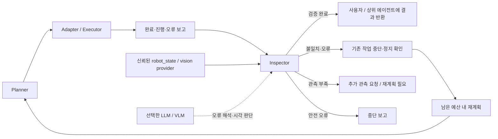

# Mission Inspector (감시자)

`coegent.inspector`는 실행기·서브 에이전트의 보고를 **독립적인 관측**과 비교하는 별도 Python 모듈이다. 같은 CoEgent 프로세스에서 사용하며, 별도 상시 서버나 모델을 자동 실행하지 않는다.



## 판단과 결과

- `completed`: 배포 설정의 모든 검증 조건이 최신 관측으로 확인됨. 실행 완료 보고만으로는 성립하지 않는다.
- `replan`: 완료 보고와 상태 불일치 또는 복구 가능한 실행 오류. 진단과 비교 결과를 planner feedback으로 전달한다.
- `request_evidence`: 관측 누락·만료·다른 mission/revision·모델 실패·검증 기준 없음. 완료 확정 금지.
- `continue`: 일반 진행 보고나 개별 단계의 완료. 전체 미션의 완료를 의미하지 않는다.
- `halt`: 안전·치명적 오류. 모델이 성공이나 재시도로 바꿀 수 없다.

실행 결과에 `inspections`(native) / `inspection`(A2), `mission_success`, `completion_report`가 추가된다. 상위 호출자는 `completion_report.verified == true`와 `next_action == "report_complete"`를 확인한다. 별도 메시지 전송 서버나 사용자에게 연락하는 기능은 추가하지 않았다. API 반환 또는 CLI 출력 JSON을 상위 시스템이 받는다.

Inspector는 명시적으로 주입/설정할 때 활성화된다. 기존 Inspector 미설정 실행의 동작·goal 검증 계약은 유지한다. `plan` 모드는 실행/완료 검증을 하지 않는다.

## 무엇을 완료 기준으로 삼는가

기준은 사용자가 승인한 미션 또는 배포 설정에서 작성한다. LLM이 생성한 자유형 `success_criteria` 문자열을 자동으로 신뢰하거나 실행 결과를 센서 데이터로 재사용하지 않는다.

`checks`는 `source: robot_state|vision`, 점으로 구분한 `path`, `op: eq|near`, `expected`를 지정한다. `near`는 숫자의 절댓값 차이 또는 같은 차원의 벡터의 유클리드 거리와 `tolerance`를 비교한다. bool과 숫자는 중첩 JSON에서도 구분한다. 단위·좌표계·지도는 provider와 기준을 일치시켜야 한다.

예: `robot_state.pose_xy`가 선택한 지도의 미터 좌표라면:

```json
{
  "max_age_s": 5,
  "checks": [
    {"id":"pose", "source":"robot_state", "path":"pose_xy", "op":"near", "expected":[1.0,2.0], "tolerance":0.5},
    {"id":"localized", "source":"robot_state", "path":"localization_valid", "op":"eq", "expected":true}
  ]
}
```

이 예제의 좌표는 설명용이다. 실제 목적지 좌표로 설정해야 한다. **최종 위치만 확인하면 최종 도착만 증명한다.** 경유지 방문·물체 조작·점검까지 미션에 포함된다면 해당 작업을 증명하는 별도의 관측 조건/신뢰된 이력이 필요하다. Inspector가 자연어 전체의 의미를 자동으로 완벽하게 검증한다는 뜻은 아니다. native의 기존 승인된 `request.goals`도 충족해야 한다.

## Python API

```python
from coegent import CoEgent, Inspector, InspectionConfig, InspectionSnapshot
from time import time

class RobotEvidence:
    async def snapshot(self, report):
        # 실제 센서/상태 관리자가 읽은 값과 원래 관측 시각을 반환한다.
        # 아래 메서드는 애플리케이션이 연결할 센서 인터페이스 예시이다.
        values, observed_at = await trusted_sensor.read_with_capture_times()
        return InspectionSnapshot(report.mission_id, report.revision, values, observed_at)

inspector = Inspector(InspectionConfig.from_dict({
    "checks": [{"id":"arrival", "source":"robot_state", "path":"location", "op":"eq", "expected":"A"}]
}), RobotEvidence())
agent = CoEgent(planner, backend, inspector=inspector)
result = await agent.run_request(request, state)
```

`InspectionSnapshot.values`는 `{"robot_state": {...}, "vision": {...}}`이다. `observed_at`은 UTC Unix 초로 `{"robot_state": timestamp, "vision": timestamp}` 또는 `{"robot_state.location": timestamp}`처럼 필드별 시각을 지정한다. 가장 구체적인 상위 경로의 시각이 적용된다. 미래/오래된/비유한 값은 인정하지 않는다. 모델 응답을 기다리는 동안 만료된 관측도 완료 증거로 쓰지 않는다. `StateEvidenceProvider(existing_trusted_provider)`로 기존 monotonic 시각의 CoEgent 관측 provider를 연결할 수도 있다.

Provider는 신뢰된 애플리케이션 통합 지점이다. 실행 보고 안에 들어온 `robot_state`를 복사해서 provider로 만드는 방식은 독립 검증이 아니다. 수신한 임의 필드는 ReportMessage에서 거절한다.

실행 중 보고:

```python
ack = agent.submit_report({
    "mission_id": request.mission_id, "revision": request.revision,
    "report_id": "nav-error-42", "kind": "error", "scope": "step",
    "severity": "recoverable", "message": "목적지 앞 경로가 막혔습니다."
})
```

Adapter에는 같은 동기 callback이 `ExecutorContext.report`로 제공된다. `kind`는 `progress|completed|error`, `severity`는 `recoverable|fatal|safety`다. 호출은 소유 asyncio 이벤트 루프에서 한다. 다른 스레드는 `loop.call_soon_threadsafe`로 전달한다. 네트워크/서브 에이전트 통신을 사용하는 쪽이 인증·전달을 담당한다.

mission/revision 불일치, 중복 ID, 종료된 미션, mailbox 용량 초과는 `accepted:false`로 거절한다. producer는 ack를 확인해야 한다. 완료 검증/마지막 연결 종료를 기다리는 동안 수락한 오류도 성공 보고 전에 처리한다.

## 혼합 판단: LLM / VLM

수치·상태 비교는 코드가 수행한다. 선택적 모델은 자연어 오류 진단과 승인된 시각 assertion을 담당한다.

```json
{
  "checks": [],
  "visual_assertions": [{"id":"door", "description":"전방 문이 열려 있다"}],
  "model": {"endpoint":"http://127.0.0.1:8080", "name":"configured-vision-model"},
  "model_timeout_s":15,
  "max_age_s":30
}
```

`model`은 이미 운영 중인 OpenAI 호환 HTTP endpoint를 지정한다. 새 모델을 다운로드/적재하거나 서버를 시작하지 않는다. Python에서는 `ModelReviewer(existing_model_client)`를 `Inspector(..., reviewer=...)`로 주입해 호환되는 in-process 모델도 재사용할 수 있다. `complete(messages, schema=..., max_tokens=..., require_complete=True)` 인터페이스를 사용한다.

구조화된 vision 사실은 코드 `checks`로 비교할 수 있다. 실제 프레임 판독에는 **이미지 입력을 지원하는 VLM endpoint/client**가 필요하다. 일반 텍스트 GGUF planner에 image_url을 보낸다고 이미지 해석이 가능해지지 않는다. 이미지 형식은 `vision.images`의 JPEG/PNG data URL 배열이다. 최대 4장, 기본 합계 2 MiB이며 HTTP URL 자동 다운로드는 하지 않는다.

모델 답은 JSON schema 및 승인 assertion ID 전체 일치로 검증한다. 수치 불일치를 모델의 '완료' 답으로 덮어쓰지 않는다. 모델/VLM 자체의 인식 정확도는 실제 영상·실모델 평가가 별도로 필요하다.

## CLI: 외부 보고 점검

독립 관측 파일은 `mission_id`, `revision`, `values`, `observed_at`을 갖는다. 센서 producer가 원래 시각으로 갱신해야 한다. 완료 보고 파일과 다른 입력이다.

```bash
./.venv/bin/python -m coegent inspect \
  --report CoEgent_Agent/examples/inspector/report.json \
  --inspector-config CoEgent_Agent/examples/inspector/config.json \
  --inspection-evidence /path/to/trusted-evidence.json \
  --out /tmp/inspection.json
```

`completed/continue`는 exit 0, 재계획·관측 요청·중단은 exit 2다. 이 명령 자체는 계획 생성·실행을 호출하지 않는다. native `run`/`request`에도 `--inspector-config`와 `--inspection-evidence`를 함께 전달할 수 있다. `FileEvidenceProvider`는 매 검증마다 파일을 읽으며 시각을 새로 찍지 않는다. 기본 CLI native backend는 여전히 MockSkills다.

## A2 / Isaac 연결

A2에서는 executor options의 `inspector_config` 객체 또는 CLI `--inspector-config` 파일 중 한 곳에 설정한다. 별도 evidence 파일은 사용하지 않는다. 기존 설정 파일의 경로·지도·이동 허용 값은 자동 변경하지 않았다.

A2 live provider는 실제 runtime의 battery/localization/estop과 선택한 지도에서 검증된 `robot_state.pose_xy`/`map_pose`를 읽는다. visual 검증이 설정되면 카메라 view를 획득하고 원래 수신 시각을 보존해 최대 768px JPEG로 전달한다. 이미지가 없으면 미확인이다. **정지 확인 후 오류 분석 → 검증 → ROS 연결 종료** 순서이며 카메라 분석을 상시 폴링하지 않는다.

Inspector가 설정된 실제 ROS 실행에서는 `stop_motion()`으로 소유 경로를 먼저 정지하고, 위치 증거를 제공하는 localization은 점검 중 유지한다. 점검 후 `close()`가 전체 `cancel()`을 통해 소유 localization을 정리한다. 정리 확인에 실패하면 완료로 보고하지 않는다. 외부 취소의 `cancel()`은 경로와 localization을 모두 정리한다.

`run`은 `--max-replans`와 원래의 미션/요청 만료 시간, 총 step 예산 안에서만 재계획한다. 이전 worker 정지가 확인되어야 다음 worker를 시작하며, 서로 다른 worker mission ID와 같은 상위 mission ID로 결과를 보관한다. 완료한 motion/localization/lifecycle API와 같은 이름·인자 호출을 다시 요청하는 continuation은 차단한다. 오류 보고의 `failed_step`, 완료 prefix, 남은 계획과 Inspector feedback을 새 계획 입력으로 준다. `execution_attempts`와 `continuation_planning_reports`에 각 시도가 남는다.

`request`는 플래너를 만들지 않아 `REPLAN_REQUIRED`/관측 요청을 상위 호출자에게 반환한다. A2 계획은 여전히 자동 성공 DB 등록하지 않는다. Inspector 활성화 in-process `run`은 재계획에 필요해 모델을 마지막까지 유지한다. 기존 Inspector 미설정 A2 흐름은 계획 후 모델을 해제한다.

취소 확인이 안 된 실행/추론은 안전 실패로 처리한다. 이전 추론이 끝나기 전에 엔진을 닫거나 새 실행을 시작하지 않는다. 같은 프로세스에서 취소를 무시하는 임의 plugin을 강제로 종료할 수는 없다. 그런 plugin은 취소 협조 구현 또는 별도 프로세스 격리가 필요하다.

## 검증 범위

[최초 검증 기록](../results/inspector_20261020/REPORT.md)에 CPU 회귀 테스트와 코드 리뷰의 수정 사항을 기록한다. 최초 구현 검증에서는 실제 로봇 이동·Isaac 미션·모델 추론을 실행하지 않았다.

[추가 E4B 실모델 평가](../results/inspector_mission_eval_20261020/REPORT.md)는 실제 외부 E4B와 통제된 로봇/ROS I/O로 완료 판정·재계획을 비교했다. A2 API 프로필은 7/7 통과했지만 기본 skill의 대상 이동 재계획은 0/3이었고, Inspector는 미완료를 거절했다. 선택적 LLM 오류 분석 응답은 14회 중 2회만 계약 검증을 통과했다. 실제 Isaac 주행·실영상 VLM 정확도 평가는 포함하지 않는다.

[A2-SIM-LLM-A6000 실제 North 왕복](../../A2_Execution_Adapter/results/north_return_live_20261020/REPORT.md)에서는 실제 왕복을 수행했고, localization을 점검 전에 종료하던 버그를 발견해 위 순서로 수정했다. 전체 696개 회귀 테스트와 이동 없는 실제 ROS 완료 재점검은 통과했다. 최초 자동 완료 판정 실패 기록을 보존했으며, 수정 후 왕복 전체를 재실행한 결과는 아니다.

## LangGraph 연결

2026-10-21부터 native의 실행·완료 점검·정지·오류 진단·재계획 분기는 LangGraph 노드로 실행한다. A2는 host continuation 그래프와 worker의 실행→정지→Inspector 그래프를 구분한다. Inspector 판단 기준과 독립 증거 요구는 그대로이며, 취소 시 자원 정리와 실제 정지는 그래프 진행 여부와 관계없이 보장해야 한다. 상세 구조와 계획 전용 질문 재개 API는 [LANGGRAPH.md](LANGGRAPH.md)에 있다. 실제 로봇 그래프의 체크포인트 자동 replay는 활성화하지 않는다.
