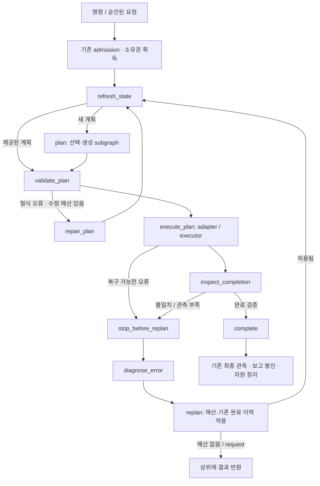

# CoEgent LangGraph 워크플로우

2026-10-21. 기존 `plan`, `run`, `request`, Python API와 A2 실행 경로가 실제 LangGraph `StateGraph`로 단계와 분기를 실행한다. LangChain 모델 래퍼나 별도 LangGraph 서버는 필요하지 않으며, 기존 HTTP / inprocess / ScriptedPlanner를 사용한다.

## 현재 실행 구조



- `dispatch`: `select_planner → generate_plan` 또는 `clarify`. 재사용 시 DB 계획을 기존 ScriptedPlanner로 반환한다. 노드마다 LLM을 새로 호출하는 구조가 아니며 기존 호출 수를 유지한다.
- `planning`: `prepare_context → call_planner → validate_plan → report`, 형식 오류는 `repair_plan`으로 제한된 횟수만 반복한다. 실행기를 만들거나 stop·실행·성공 DB 저장을 하지 않는다.
- `native`: 위 미션 그래프가 이전 mission 반복문을 대체한다. admission, 독립 safety monitor, 취소 중 소유권 유지, 최종 보고 봉인은 그래프 바깥의 필수 보호 경계로 남는다. LangGraph와 기존 반복문이 동시에 재계획을 지시하지 않는다.
- `a2_continuation`: host에서 `execute_plan → evaluate_result → plan_remaining → validate_continuation` 분기를 관리한다. 이전 worker 정지·정리를 확인한 뒤 새 worker ID로 남은 작업만 실행한다.
- `a2_worker`: `execute_plan → stop_motion → inspect_completion → finish`. Inspector 설정 시 위치 인식은 점검 동안 유지한다. 전체 `runtime.close()`는 예외·취소를 포함해 항상 실행되어 소유 localization을 정리한다.

안전 오류는 기존 코드가 중단한다. 노드의 자동 재시도 정책은 설정하지 않았다. 완료된 이동·조작을 그래프가 임의로 반복할 수 없다. 미션·skill·모델 timeout과 step/repair/replan 예산은 기존 값이 적용된다. 기존 `request`에는 숨겨진 계획 생성이 추가되지 않는다. Inspector가 없는 실행이 검증된 미션 성공으로 바뀌지도 않는다.

## 그래프와 실행 이력 보기

```bash
./.venv/bin/python -m coegent graph --flow native --out /tmp/coegent-native.mmd
./.venv/bin/python -m coegent graph --flow planning
./.venv/bin/python -m coegent graph --flow dispatch
./.venv/bin/python -m coegent graph --flow a2_continuation
./.venv/bin/python -m coegent graph --flow a2_worker
./.venv/bin/python -m coegent graph --flow planning_session
```

이 명령은 모델·ROS·로봇을 실행하지 않는다. `.mmd`는 Mermaid 지원 뷰어에서 볼 수 있다. 기존 보고서의 `trace`에는 `workflow_node_start`, `workflow_node_end`, `workflow_node_error`와 `graph`·`node`가 추가된다. A2 host 분기는 `workflow_trace`, worker 단계는 원래 `trace`에 기록한다. `orchestrator: langgraph`로 실행 경로를 확인할 수 있다.

## 추가 질문 영속 저장과 재개

`PlanningSession`은 **계획 전용** SQLite 체크포인트 API다. `interrupt()`로 질문을 저장하고 `Command(resume=answer)`로 이어간다. 명령, 호출자가 제공한 상태 snapshot, 질문·답변, 계획 보고서만 저장하며 모델/SDK/실행기 객체는 저장하지 않는다.

```python
from coegent import PlanGenerator, PlanningSession

# planner / selector / state는 기존 앱에서 구성한다.
# A2에서는 기존 A2ToolProfile(source_root, scene_dir=...)도 전달한다.
generator = PlanGenerator(planner, planner_selector=selector, tool_profile=profile)
session = PlanningSession(generator, "data/workflow_checkpoints.sqlite3")

result = await session.start("request-42", "거기로 이동해", state)
# NEEDS_CLARIFICATION이면 result['question']을 사용자에게 전달한다.
# 프로그램 재시작 후에도 같은 DB, thread_id와 동일 계약의 generator를 구성한다.
result = await session.resume("request-42", "North end를 말한 거야")
status = await session.get_state("request-42")  # 모델 추론 없음
```

`PLAN_READY` 결과는 `result['report']['plan']`에 있다. **여전히 NOT_EXECUTED**이며 실제 실행은 별도 승인·현재 상태 검증·adapter를 거쳐야 한다. 기존 `plan` CLI는 한 번의 계획 결과를 반환하고, 영속 질문 대기는 위 API를 명시적으로 사용하는 경우에 적용된다.

같은 thread의 동시 호출은 프로세스 파일 잠금으로 거절한다. 이미 존재하는 thread에 새 `start`를 보내거나 대기하지 않는 thread를 `resume`하면 거절한다. 정책·툴 계약·지도 바인딩이 달라지면 새 thread가 필요하다. 질문 횟수는 기본 8회로 제한된다. 저장한 robot_state는 당시 snapshot이므로 답변 후 생성한 계획도 실행 직전에 다시 관측·검증해야 한다.

| 저장소 | 역할 |
|---|---|
| `plans.sqlite3` | 재사용 계획 카탈로그 |
| 호출자가 지정한 `workflow_checkpoints.sqlite3` | 계획 대기·답변·단계 상태 |
| A2 adapter runtime journal | 실제 실행 소유권·재실행·미확정 동작 보호 |

체크포인트에는 전용 DB를 사용한다. 기존 카탈로그·journal 등 다른 테이블이 있는 DB는 거절한다.

## 복구 범위

이번 통합은 **실제 로봇 미션의 프로세스 재시작 후 자동 주행 재개를 제공하지 않는다.** 물리 실행 그래프에는 checkpointer를 연결하지 않았다. 미션 중 종료됐다면 journal, 현재 위치, 완료한 작업을 먼저 대조해야 한다. 과거 그래프 상태만 불러와 이동을 반복하면 안 된다. LangGraph의 그래프 pause가 로봇 정지 명령을 대신하지도 않는다.

모델 정확도·센서 정확도·로봇 주행 속도는 별도 문제다. 그래프 도입 자체가 이전 실주행의 정확도를 바꾸거나 vision/VLM 검증을 추가하지 않는다. 이번 구현 검증은 CPU/통제 I/O 회귀 검사이며, 별도 실모델·시뮬레이터 주행은 실행하지 않았다.

## 설치와 A2 이미지

```bash
./.venv/bin/python -m pip install -e ./Executor_Adapters -e ./CoEgent_Agent -e ./A2_Execution_Adapter
# 기존 a2-llm-planner:sim 기반의 CoEgent 소유 worker 이미지만 빌드한다.
docker build -t coegent-a2-adapter:sim - < A2_Execution_Adapter/Dockerfile
```

의존성은 `langgraph>=1.2.16,<2`, `langgraph-checkpoint-sqlite>=3.1.2,<4`다. 별도 유료 서비스·클라우드 키는 필요하지 않다. API trace를 외부 서비스에 보내려면 별도로 해당 서비스를 구성해야 한다.

구현: [workflow.py](../coegent/workflow.py), [planning_session.py](../coegent/planning_session.py), [planning_dispatch.py](../coegent/planning_dispatch.py), [planning.py](../coegent/planning.py), [agent.py](../coegent/agent.py). [검증 보고서](../results/langgraph_20261021/REPORT.md).
