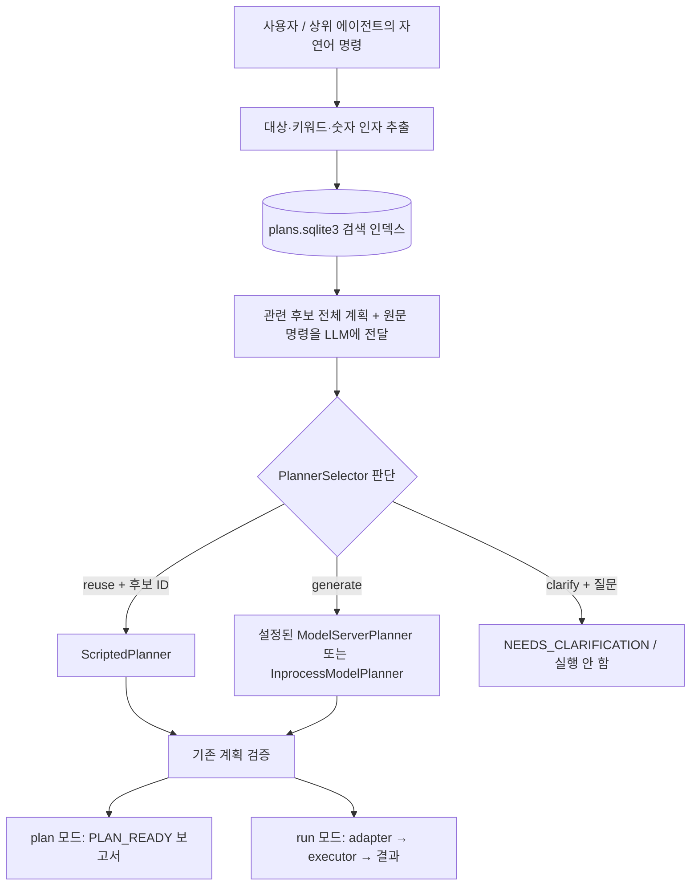

# PlannerSelector — 저장 계획 재사용 / 새 생성 / 추가 질문

`PlannerSelector`는 CoEgent 안에서 동작합니다. 별도 서버를 추가하지 않으며, 판단에 쓰는 LLM은 HTTP 모델 서버 또는 같은 프로세스의 모델을 선택합니다. `--planner auto` 또는 Python의 `planner_selector=`로 활성화합니다. 기존 file/db/http/hf 직접 선택과 제공된 계획을 실행하는 request는 유지합니다.



## 선택 방식

2026-10-16 개선: 한국어 프롬프트가 명령의 정보 부족을 먼저 확인하고, 이유를 쓴 뒤 판정을 출력하도록 바꿨습니다. 목적지·회전각·대상이 없을 때 후보 값으로 채우지 않는 예시와, 복귀 누락·다른 동작을 재사용하지 않는 예시를 포함합니다. HTTP schema 제약이 활성화된 경우 실제로 보여준 ID에만 reuse를 허용하고, decision별 plan_id/question 조합을 anyOf 분기로 제한합니다. 빈 후보에서는 reuse 분기를 보내지 않습니다. 공개 결과의 네 필드와 기존 사후 검증은 유지합니다.

분기 schema는 로컬 llama.cpp HTTP에서 실측했습니다. 모든 schema 서버가 root anyOf를 지원한다고 가정하지 않습니다. 미지원 서버는 명시적인 오류로 실패하며 자유 생성으로 자동 재시도하지 않습니다. `--generation-mode unconstrained`로 요청 제약을 끌 수 있지만 이 경우 분기 제약은 사후 검증에만 적용됩니다. InprocessModelPlanner도 프롬프트와 사후 검증을 사용하며 이번 HTTP 모델 정확도 결과를 그대로 적용할 수 없습니다.

실모델 비교와 한계: [2026-10-16 판단 정확도 평가](../results/planner_selector_accuracy_20261016/REPORT.md).

이번 평가에서는 운영용 추천 모델을 찾지 못했습니다. 형식 오류는 감소했지만, 일부 모델에서는 유효한 잘못된 reuse가 늘었습니다. 현재 auto 선택을 검토가 필요한 실험 기능으로 취급하며 JSON 유효성을 의미 정확성이나 실행 승인으로 해석하지 마세요.

1. Unicode 정규화, 한국어 조사 변형, 동작 키워드와 숫자 추출을 수행합니다. 현재 State의 알려진 장소·대상 이름도 비교합니다. 이 규칙은 후보 검색에만 사용합니다.
2. SQLite `plan_search_terms(term)` 인덱스를 조회합니다. 대상·인자 일치에 가중치를 주고 기본 최대 5개 후보를 가져옵니다. 매 요청마다 DB 전체 계획 본문을 LLM에 보내지 않습니다.
3. LLM에 원문 명령과 후보의 **전체 계획**·연결 명령·요청 목표·허용 skill·일부 로봇 상태를 보냅니다. 기본 프롬프트 한도는 UTF-8 12,000바이트입니다. 한도에 안 들어가는 후보는 통째로 제외합니다.
4. LLM 응답은 `reuse`, `generate`, `clarify` 세 가지입니다. 대상, 수치, 순서, 조건, 복귀와 금지 지시까지 맞아야 재사용하도록 지시합니다. 후보가 없어도 모호성 확인을 위해 LLM에 질문합니다.
5. `reuse`는 **실제로 보여준 후보 ID**만 허용합니다. 비교했던 계획 스냅샷을 ScriptedPlanner에 넘깁니다. LLM이 임의로 돌려준 계획은 실행하지 않습니다. `generate`의 백엔드는 사전 설정으로 정하며 LLM이 서버·모델·실행기를 바꾸지 않습니다.

응답 예:

```json
{"decision":"reuse","plan_id":12,"reason":"대상과 전체 작업이 일치함","question":null}
```

```json
{"decision":"clarify","plan_id":null,"reason":"목적지가 없음","question":"어느 장소로 이동할까요?"}
```

단어 일치가 의미의 동일성을 증명하지는 않습니다. 검색에서 놓친 동의어는 새 생성으로 이어질 수 있고, LLM도 잘못 판단할 수 있습니다. 실제 배포 모델의 부정 표현·숫자 변경·추가 작업·복귀 조건 판단은 별도 평가가 필요합니다. 기존 상태·권한·안전·미션·목표 검증과 adapter 경계는 계속 적용됩니다.

## CLI

`local_ai_study`에서 실행합니다. 모델 서버는 별도로 실행되어 있어야 합니다. 예시의 `planner`는 서버에서 제공하는 모델 별칭입니다.

```bash
# 같은 HTTP 모델로 선택과 새 생성: 계획만 확인
./.venv/bin/python -m coegent plan --planner auto \
  --generation-planner http --endpoint http://127.0.0.1:18200 --model planner \
  --command 'A로 이동해' --out /tmp/selected-plan.json

# 선택한 계획을 adapter를 거쳐 실행 (기본 backend는 MockSkills)
./.venv/bin/python -m coegent run --planner auto \
  --endpoint http://127.0.0.1:18200 --model planner \
  --command 'A로 이동해' --out /tmp/selected-run.json

# 선택 전용 HTTP 모델을 따로 사용
./.venv/bin/python -m coegent plan --planner auto \
  --endpoint http://127.0.0.1:18200 --model planner \
  --selector-backend http --selector-endpoint http://127.0.0.1:18300 --selector-model judge \
  --command '현재 위치 알려줘'

# 같은 프로세스의 HF 모델 하나를 선택/생성에 공유
./.venv/bin/python -m coegent plan --planner auto --generation-planner hf \
  --model /absolute/path/to/hf-model --command 'A로 이동해'
```

- `--selector-backend same`이 기본값입니다. 생성용 클라이언트/모델 객체를 공유하므로 HF 모델을 두 번 적재하지 않습니다.
- `--selector-backend hf --selector-model /path`로 별도 inprocess 판단 모델을 지정할 수 있습니다. 선택적 `--selector-adapter`는 그 모델의 PEFT adapter입니다. 생성 모델은 기존 `--adapter`를 사용합니다.
- HF 모델은 설정 시 생성자에서 적재합니다. 별도 HF 생성 모델과 HTTP 선택기를 구성하면 재사용 결정 전에도 HF 생성 모델이 메모리에 올라갑니다. 서로 다른 HF 모델 두 개를 지정하면 둘 다 적재합니다.
- `--generation-mode auto`는 HTTP schema 요청, HF 프롬프트 생성+사후 검증입니다. HF grammar 제약은 추가하지 않았습니다. HTTP schema 미지원 서버는 `--generation-mode unconstrained`를 명시할 수 있으며 JSON 사후 검증은 유지합니다.
- `--selector-max-candidates` 1~20, `--selector-max-tokens` 64~4096, `--selector-max-prompt-bytes` 3000~100000으로 조절합니다. 생성 길이는 기존 `--max-tokens`입니다.
- 한 planning 호출의 `--planner-timeout`에 검색·선택·필요한 새 생성을 포함합니다. 취소된 선택 결과가 늦게 와도 새 생성이나 실행을 시작하지 않습니다. 정리가 남은 inprocess 추론이 있으면 같은 생성기/미션 소유자의 다음 호출을 막습니다. HTTP 요청 취소가 서버 추론 중단을 보장하지는 않습니다.
- 기존 offline 정책은 `RuntimeConfig(remote_required=True, ...)`와 connection probe가 설정됐을 때 적용됩니다. selector와 새 생성 직전 각각 검사합니다. 기본 CLI에는 별도 연결 probe가 없으므로 HTTP 연결 실패는 PLANNER_ERROR입니다.

`--plan-db` 또는 `COEGENT_PLAN_DB`로 DB를 바꿀 수 있습니다. `--state` 생략 시 기존 mock fixture를 사용합니다.

## 명령 저장과 DB 마이그레이션

```bash
./.venv/bin/python -m coegent plans add \
  --plan-file /path/to/plan.json --command 'A로 이동해' --source agent
./.venv/bin/python -m coegent plans show --plan-id 1
```

계획 본문의 중복 기준은 그대로입니다. 같은 계획을 다른 `--command`로 다시 추가하면 새 계획 행을 만들지 않고 `plan_commands`에 연결 명령을 추가합니다. 성공 실행의 명령도 저장됩니다. `plans show`의 `commands`에서 확인할 수 있습니다. 첫 등록의 대표 command/title/author는 유지합니다.

DB v1은 처음 열 때 v2로 트랜잭션 마이그레이션합니다. 계획 ID·본문·해시·성공 이력을 유지하고 기존 명령으로 검색 인덱스를 만듭니다. v1에 이미 보관되지 않았던 과거 별칭은 복원할 수 없습니다. `ScriptedPlanner` 자체는 자연어를 판단하지 않으며, Selector가 고른 계획을 반환하는 역할입니다.

## Python API와 추가 질문 처리

```python
from coegent import CoEgent, PlanGenerator, PlanStore, PlannerSelector
from coegent.planner import ModelServerPlanner

store = PlanStore()
model = ModelServerPlanner('http://127.0.0.1:18200', 'planner')
selector = PlannerSelector(store, model)
generator = PlanGenerator(model, planner_selector=selector)
result = await generator.generate(command, state)
# 통합 실행: CoEgent(model, backend, planner_selector=selector, plan_store=store)
```

`command`, `state`, `backend`는 호출자가 제공합니다. `await`는 async 함수 안에서 사용합니다. 결과의 `planner_selections`에는 추출 특징·후보 ID·판단·선택된 planner가 남습니다. `planner_calls`는 기존 planning 시도 횟수이며 auto의 실제 모델 호출 수와 같지 않습니다. 처음에는 선택 1회, 새 생성이면 추가 1회입니다. repair/replan은 완료 작업을 반복하지 않도록 DB 재사용 판단을 건너뛰고 남은 작업 생성으로 보냅니다.

불명확하면 `status=NEEDS_CLARIFICATION`, `execution_status=NOT_EXECUTED`, `question=...`를 반환합니다. plan 결과는 `plan=null`이고 CLI 종료 코드는 2입니다. 초기 질문에서는 stop을 포함한 skill을 호출하지 않고 성공 계획도 저장하지 않습니다. CLI는 stdout에도 질문을 출력합니다. 대화 UI/상위 에이전트는 이 질문을 사용자에게 전달하고, 답변을 반영한 완전한 명령으로 다시 호출해야 합니다. 자동 대화 대기나 대화 기억 서버는 추가하지 않았습니다.

잘못된 JSON·후보 밖 ID·잘린 모델 응답·통신 오류는 PLANNER_ERROR로 처리합니다. 임의의 후보를 대신 실행하지 않습니다. 실제 작업 중 발생한 안전 문제와 취소에는 기존 정지/복구 규칙을 적용합니다.
