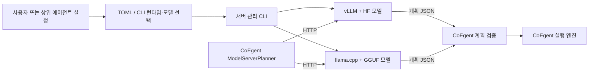

# 독립 로컬 LLM 모델 서버

CoEgent와 별도 프로세스로 실행하며 **시작 전에 런타임과 모델을 선택**합니다.

| 런타임 | 모델 형식 | 기본 프로필 |
|---|---|---|
| `vllm` | HF checkpoint, 선택적 PEFT LoRA | [config/server.toml](config/server.toml): Gemma4 + Planner LoRA |
| `llamacpp` | GGUF 파일, 선택적 GGUF LoRA | [config/llamacpp.toml](config/llamacpp.toml): Gemma4 robot-SFT Q8_0 |

llama.cpp 실행 파일과 프로젝트 라이브러리를 `runtimes/llamacpp/`에 설치했습니다. vLLM은 전용 `.venv`에서 실행합니다. 한 번에 하나의 관리 서버를 사용하며 두 엔진 모두 `ModelServerPlanner`가 사용하는 HTTP API를 제공합니다.

사용 모델은 서버 내부 `model/`에 복사해 보관합니다. HF checkpoint는 `model/hf/`, Planner LoRA는 `model/adapters/`, GGUF는 `model/gguf/`에 있습니다. 원본 대비 크기·SHA256 확인 결과와 출처는 `model/COPY_MANIFEST.json`에 기록했습니다. 기본 프로필은 이 내부 복사본을 사용합니다.

추가 E4B 모델은 `model/gguf/gemma-4-E4B_q4_0-it.gguf`(Google IT QAT Q4_0)와 `model/hf/gemma-4-E4B-it/`(Google IT BF16)입니다. 출처·revision·SHA256은 각 `*.source.json`에 기록합니다. CoEgent의 `InprocessModelPlanner` 기본값도 이 **GGUF와 동일한 llama.cpp 라이브러리**를 사용합니다. HF 사본은 명시적인 `TransformersModelPlanner` / `--planner hf`용으로 유지합니다.

```bash
# 외부 E4B GGUF: 내부와 같은 템플릿·ctx·threads·GPU 설정
bash LLM_Model_Server/scripts/server.sh --config LLM_Model_Server/config/e4b.toml start
```

내부 추론용 bridge는 `./.venv/bin/python LLM_Model_Server/scripts/build_inprocess.py`로 빌드합니다. `native/inprocess.cpp`가 설치된 `libllama-server-impl`, `libllama-common`, `libllama`에 연결하며, JSON 요청을 메모리 안에서 처리합니다. 소켓을 열거나 모델 자식 프로세스를 만들지 않습니다. 설치된 runtime과 같은 revision의 소스/빌드 헤더가 필요하며, 버전·해시는 `runtimes/llamacpp/inprocess_manifest.json`에 기록합니다. upstream llama.cpp 소스는 변경하지 않습니다. CoEgent에서는 `--planner inprocess`로 선택합니다. 외부 서버의 기존 기본 프로필은 유지합니다.

**기본 GGUF에는 현재 Planner-SFT LoRA가 포함되지 않습니다.** 동일한 학습 결과가 필요하면 Planner LoRA를 병합한 모델을 GGUF로 변환하거나 호환되는 GGUF LoRA를 명시적으로 지정해야 합니다.

## 실행과 선택

아래 명령은 `local_ai_study`에서 실행합니다. 선택 옵션은 `start/status` 등의 명령 **앞에** 넣습니다.

```bash
# GGUF / llama.cpp
bash LLM_Model_Server/scripts/server.sh --runtime llamacpp doctor
bash LLM_Model_Server/scripts/server.sh --runtime llamacpp start
bash LLM_Model_Server/scripts/server.sh --runtime llamacpp status
bash LLM_Model_Server/scripts/server.sh --runtime llamacpp client-config

# 기존 HF + Planner LoRA / vLLM으로 전환
bash LLM_Model_Server/scripts/server.sh stop
bash LLM_Model_Server/scripts/server.sh --runtime vllm start
bash LLM_Model_Server/scripts/server.sh --runtime vllm client-config

# 사용 후 메모리 반환
bash LLM_Model_Server/scripts/server.sh stop
```

`--runtime`을 생략하면 기존 vLLM 프로필을 선택합니다. `--config`가 있으면 해당 TOML을 사용하고 CLI 옵션이 설정을 덮어씁니다. 실행 중인 서버가 다른 모델·런타임·엔진 설정을 사용하면 `status`는 `config_changed`를 반환합니다. `start`는 기존 서버를 교체하지 않으므로 먼저 `stop`해야 합니다. `stop`은 공유 상태에 등록된 서버를 종료합니다.

다른 GGUF를 선택하는 예:

```bash
bash LLM_Model_Server/scripts/server.sh --runtime llamacpp \
  --model-path LLM_Model_Server/model/gguf/gemma4-e2b-sft-v0.4-Q4_K_M.gguf \
  --model-name coegent-gemma4-q4 start

# 같은 선택 옵션으로 연결 정보 확인
bash LLM_Model_Server/scripts/server.sh --runtime llamacpp \
  --model-path LLM_Model_Server/model/gguf/gemma4-e2b-sft-v0.4-Q4_K_M.gguf \
  --model-name coegent-gemma4-q4 client-config
```

CLI 상대 경로는 **명령을 호출한 디렉토리**, TOML 내부 상대 경로는 **그 TOML의 디렉토리**가 기준입니다. 지속적으로 사용할 설정은 TOML에 저장하고 `server.sh --config /경로/my-model.toml start`로 실행하세요.

HF 프로필의 모델을 바꿀 때 기존 adapter를 자동 재사용하지 않습니다. `--adapter-path /경로/adapter` 또는 `--no-adapter`로 의도를 명시해야 합니다. HF checkpoint와 GGUF의 형식이 런타임과 맞지 않으면 시작 전에 오류를 반환합니다. 실제 모델 아키텍처·adapter 호환성은 선택한 엔진에서도 검증됩니다.

## 자원 설정

| 설정 | vLLM 기본값 | llama.cpp 기본값 |
|---|---|---|
| 주소 | `http://127.0.0.1:18520` | 동일 |
| 요청 모델 별칭 | `coegent-planner` | `coegent-gemma4-gguf` |
| 요청당 문맥 / 동시 sequence | 4096 토큰 / 1 | 4096 토큰 / 1 |
| GPU | 전체 VRAM의 0.40 예산 | `gpu_layers = -1`: 전체 레이어 offload |
| 최소 가용 RAM 점검 | 6 GiB | 6 GiB |
| GPU 사전 점검 | 예산 + 1 GiB 여유 | 최소 가용 VRAM 4 GiB |

llama.cpp는 `--gpu-layers 0`으로 CPU 모드, `--gpu-layers N`으로 일부 레이어 offload를 선택합니다. `--threads`로 CPU thread 수를 설정합니다. CPU 모드에는 가용 GPU를 요구하지 않습니다. 현재 설치는 CUDA 빌드이므로 CPU 모드에서도 링크된 시스템 CUDA 라이브러리는 필요합니다. GPU 없는 환경은 아래 소스 빌드 옵션으로 CPU 바이너리를 만들 수 있습니다.

TOML의 `max_model_len`, `max_num_seqs`는 각각 요청당 문맥과 동시 slot 수입니다. llama.cpp에는 그 곱을 전체 `--ctx-size`로 전달합니다. 입력과 출력은 문맥을 함께 사용합니다. 선택적 `chat_template_path`로 모델별 Jinja 템플릿을 지정할 수 있습니다.

사전 점검은 실제 메모리 요구량을 보장하지 않습니다. 모델 크기·KV cache·동시 요청에 따라 자원이 달라집니다. `doctor`로 점검하고 `command`로 정확한 실행 인자를 확인하세요.

## CoEgent 및 상위 에이전트 연결



선택은 사전 설정입니다. 자연어 요청을 보고 LLM이 런타임을 고르는 구조는 아닙니다. 서버는 모델 추론을 담당하고 도구 실행·안전 정책·계획 검증은 CoEgent에서 처리합니다.

`client-config`는 선택된 런타임/모델과 `ModelServerPlanner` 생성자 인자를 JSON으로 출력합니다. 상위 에이전트는 동일한 선택 옵션으로 `start`와 `client-config`를 호출하고 `server.status == "ready"`를 확인한 뒤 `planner_settings`를 전달하면 됩니다.

```python
# PYTHONPATH에 LLM_Model_Server와 CoEgent_Agent를 추가한 환경
from local_llm_server.config import load_config
from local_llm_server.lifecycle import start, status
from coegent.planner import ModelServerPlanner

config = load_config("LLM_Model_Server/config/llamacpp.toml")
start(config)  # 이미 실행 중이면 start 대신 status로 선택 일치 확인
assert status(config)["status"] == "ready"
planner = ModelServerPlanner(**config.planner_settings)
# planner를 기존 PlanGenerator/CoEgent 구성에 주입
```

GGUF 기본 프로필로 CoEgent CLI를 실행하는 예:

```bash
PYTHONPATH=CoEgent_Agent ./.venv/bin/python -m coegent plan \
  --planner http --endpoint http://127.0.0.1:18520 \
  --model coegent-gemma4-gguf --command '현재 배터리를 확인해.' \
  --out LLM_Model_Server/results/plan.json
```

vLLM 프로필에서는 `--model coegent-planner`를 사용합니다. CoEgent HTTP client 소스는 변경하지 않았습니다.

## 설치와 유지보수

현재 PC에는 두 런타임 모두 설치했습니다. 새 환경 복원 시:

```bash
# vLLM 전용 Python 환경과 고정 의존성
bash LLM_Model_Server/scripts/setup.sh

# 기존 로컬 빌드의 native 바이너리·프로젝트 라이브러리 복사
bash LLM_Model_Server/scripts/setup_llamacpp.sh
bash LLM_Model_Server/scripts/setup_llamacpp.sh --from-build /경로/llama.cpp/build

# 소스 빌드: 출력은 서버의 runtimes/llamacpp-build
bash LLM_Model_Server/scripts/setup_llamacpp.sh --source /경로/llama.cpp
# GPU 없는 환경에서 CPU 빌드
SERVER_LLAMA_CUDA=OFF bash LLM_Model_Server/scripts/setup_llamacpp.sh --source /경로/llama.cpp
```

설치기는 실행 파일, 프로젝트 라이브러리, 라이선스, 버전·SHA256 manifest를 서버 디렉토리에 보관합니다. 원본 빌드로 연결되는 라이브러리 symlink를 유지하지 않습니다. 설치 버전은 **llama.cpp `0.3.0-dev`, commit `b96806d`**입니다. 현재 PC의 시스템 CUDA 13·드라이버·libc/OpenSSL 의존성은 별도로 필요하며 다른 PC에서는 재빌드가 필요할 수 있습니다. 이번 검증은 기존 빌드의 독립 설치 경로를 사용했고 전체 CUDA 소스 재빌드는 실행하지 않았습니다.

vLLM은 **0.19.1 / Transformers 5.5.4 / PyTorch 2.10.0**을 고정합니다. Gemma4에만 텍스트 클래스 override와 공유 KV 레이어 `k_norm` 호환 plugin을 적용합니다. 다른 HF 모델에는 Gemma4 override를 적용하지 않습니다. 원본 모델·adapter·vLLM 소스는 변경하지 않습니다. JSON 출력에는 xgrammar와 `disable_any_whitespace=true`를 사용합니다.

## 검증

```bash
# 가중치 로딩 없이 엔진 옵션/모델 클래스 확인
python3 LLM_Model_Server/scripts/check_runtime.py --runtime llamacpp
LLM_Model_Server/.venv/bin/python LLM_Model_Server/scripts/check_runtime.py --runtime vllm

# 서버 ready일 때 실제 HTTP schema → CoEgent 계획 검증
python3 LLM_Model_Server/scripts/smoke_coegent.py --runtime llamacpp
LLM_Model_Server/.venv/bin/python LLM_Model_Server/scripts/smoke_coegent.py --runtime vllm

# 모델 추론 없는 HTTP 프로세스 fixture / 설정 / 설치 테스트
PYTHONPATH=LLM_Model_Server python3 -m unittest discover -s LLM_Model_Server/tests -v
```

smoke는 schema 제약과 `finish_reason == "stop"`을 검사한 뒤 실제 `PlanGenerator`로 계획을 검증합니다. `PLAN_READY`, `NOT_EXECUTED`를 확인하며 도구를 실행하지 않습니다. 기존 `ModelServerPlanner`는 응답 완료 이유를 검사하지 않으므로 첫 연결 검증에는 smoke를 사용하세요. 결과와 한계는 [RUNTIME_SELECTION_VERIFICATION.md](RUNTIME_SELECTION_VERIFICATION.md), 이전 vLLM 검증은 [VERIFICATION.md](VERIFICATION.md)에 기록했습니다.

## 디렉토리와 프로세스 관리

```text
LLM_Model_Server/
├── config/{server,llamacpp}.toml    런타임·모델 프로필
├── model/{hf,adapters,gguf}/        서버가 사용하는 모델 복사본
├── local_llm_server/
│   ├── config.py                   설정 검증 및 선택 정보
│   ├── runtimes.py                 런타임별 argv·환경
│   ├── runtime_install.py          독립 native 엔진 설치
│   ├── lifecycle.py                자원·HTTP 준비·프로세스 관리
│   └── cli.py                      선택과 관리 명령
├── scripts/                        설치·서버·연결 검증 진입점
├── runtimes/llamacpp/               llama-server, 라이브러리, manifest
├── .venv/                          vLLM 환경
├── run/server.json                 현재 서버 식별 및 엔진 설정
├── logs/server.log                 서버 로그
└── results/                        검증 결과
```

`start`는 독립 프로세스 그룹을 만들고 `/health` 및 `/v1/models`의 모델 별칭을 확인합니다. 터미널이 종료돼도 유지됩니다. `stop`은 PID·시작 시각·세션·instance 표식으로 소유권을 확인한 프로세스만 종료합니다. 확인할 수 없는 경우 상태 파일을 유지하고 오류를 반환합니다.

두 엔진은 loopback에만 바인딩하며 모델을 자동 다운로드하지 않습니다. 이미 점유된 포트를 탈취하지 않습니다. foreground 운영은 `server.sh [선택 옵션] run`을 사용하며 이 모드는 `status/stop` 관리 대상에 등록되지 않습니다.
